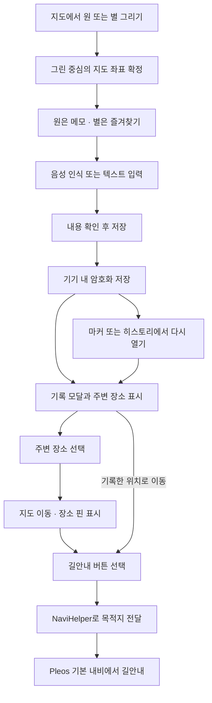
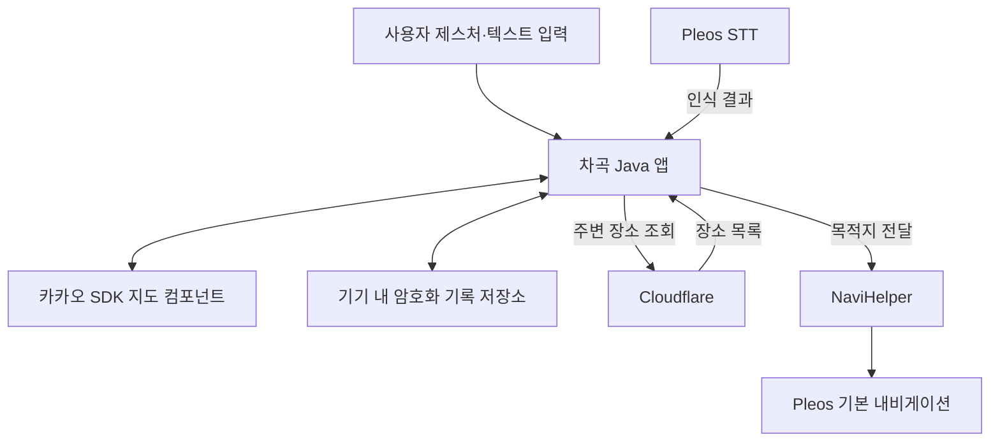

# 차곡 · CHAGOK

**간단한 제스처로 차량 생활의 순간을 기록하고, 다시 찾고, 찾아가는 Pleos 앱**

> 차량이 곧 나의 다이어리가 됩니다.

## 차 안에서 쌓이는 나만의 기록

지나가다 눈에 들어온 가게, 다음에 다시 들르고 싶은 장소, 그곳에서 떠오른 짧은 생각. 장소와 함께 남겨 두고 싶은 순간은 차량 안에서도 생깁니다.

차곡은 지도에 원이나 별을 그려 그 위치에 나만의 기록을 남깁니다. 기록을 다시 열어 주변 가게를 살펴보고, 가고 싶은 곳은 차량 내비게이션으로 연결합니다. 이동하며 쌓인 기억이 내 차를 나만의 공간으로 만들어 갑니다.

## 카카오 지도 컴포넌트를 선택한 이유

차곡에는 **지도를 앱 안에 직접 표시하고, 사용자가 그린 지점을 좌표로 바꾸어 기록하는 기능**이 필요했습니다.

개발에 사용한 **Pleos Connect 2.1.0 에뮬레이터**의 기본 내비는 길안내와 경로선을 표시했지만, `connect_empty` 지도 스타일에서는 도로·건물·장소명이 보이지 않아 기록할 위치와 주변 가게를 고르기 어려웠습니다. 기본 내비 위에서 제스처 입력을 받는 오버레이도 시험했으나, 확인한 공개 NaviHelper API에서는 그 화면의 지점을 지리 좌표나 선택한 장소로 바꾸는 방법을 찾지 못했습니다.

이 때문에 차곡 내부에 **카카오모빌리티 내비게이션 SDK의 지도 컴포넌트(KNMapView)**를 사용하고, 주변 장소는 **Kakao Local API**로 조회하도록 구성했습니다. 지도 표시와 제스처 기록은 차곡에서 처리하고, 실제 길안내는 **Pleos 기본 내비게이션**에 목적지를 전달합니다.

이는 개발 에뮬레이터와 확인한 공개 연동 범위에서의 선택입니다. 현대 기본 내비 전체에 지도나 길안내 기능이 없다는 의미는 아닙니다.

| 역할 | 담당 |
| --- | --- |
| 앱 내부 지도·건물 표시와 화면 좌표 변환 | 카카오모빌리티 내비게이션 SDK의 지도 컴포넌트 |
| 원·별 인식, 메모·즐겨찾기, 히스토리 | 차곡 앱 |
| 주변 가게·장소 조회 | Kakao Local API |
| 목적지 전달과 실제 길안내 | NaviHelper → Pleos 기본 내비게이션 |

## 실제 앱 화면

개발 중 Pleos 에뮬레이터에서 직접 촬영한 화면입니다. 원·별 장면은 앱 영역을 잘라낸 캡처이며, 기록 내용은 시연용 샘플입니다.

<table>
  <tr><th>원으로 메모 남기기</th><th>별로 즐겨찾기 남기기</th></tr>
  <tr>
    <td></td>
    <td></td>
  </tr>
</table>

**기록과 주변 가게를 함께 확인** — 저장한 메모를 열면 글과 주변 장소 목록을 보고 길안내를 요청할 수 있습니다.

**히스토리에서 다시 찾기** — 메모와 즐겨찾기를 모아 보고, 선택한 기록의 위치로 이동합니다.

## 주요 기능

- **위치와 함께 기록하기** — 지도에 그린 위치에 메모와 즐겨찾기를 저장합니다. 음성 인식(STT) 또는 텍스트 입력으로 내용을 남길 수 있습니다.
- **기록 꺼내 보기** — 저장한 마커를 한 번 누르면 같은 디자인의 모달에서 글을 읽고 삭제할 수 있습니다.
- **기록 위치 옮기기** — 마커를 길게 누른 채 끌어 원하는 위치로 옮깁니다.
- **주변 장소 살펴보기** — 선택한 위치 주변 100m의 음식점·카페·편의점·관광지를 분류별로 확인합니다.
- **히스토리에서 다시 찾기** — 메모와 즐겨찾기 목록에서 기록을 선택하면 지도 이동과 기록 열기가 함께 이루어집니다.
- **다시 온 곳 알아보기** — 저장한 장소 근처에 다시 도착하면 해당 기록을 표시합니다.
- **차량 내비게이션 연결** — 기록한 위치나 선택한 장소의 길안내를 Pleos 기본 내비게이션으로 요청합니다.

## 제스처 사용법

| 입력 | 동작 |
| --- | --- |
| 한 손가락으로 원 그리기 | 해당 위치에 메모 남기기 |
| 한 손가락으로 별 그리기 | 해당 위치를 즐겨찾기로 기록하기 |
| 지도 두 번 터치 | 주변 장소 분류와 목록 보기 |
| 저장 마커 한 번 터치 | 메모·즐겨찾기 내용 보기 |
| 저장 마커 길게 누르고 끌기 | 기록 위치 변경하기 |
| 두 손가락 조작 | 지도 이동·확대·축소·회전 |

별도의 그리기 버튼 없이 지도에서 바로 입력합니다. PC 에뮬레이터에서는 마우스 좌우 버튼을 함께 누른 드래그로 지도를 이동할 수 있습니다.

## 사용 흐름

기록 위치는 차량의 현재 위치가 아니라 **지도에서 원·별을 그린 중심 위치**입니다. 음성 인식 결과는 저장 전에 확인하고 직접 고칠 수 있습니다.

히스토리에서 기록을 고르는 것만으로 길안내가 시작되지는 않습니다. 사용자가 길안내 버튼을 눌러 이동을 요청합니다. 저장한 곳 근처에 다시 도착하면 재방문 표시를 통해 기록을 다시 열 수 있습니다.

## 앱의 주요 연결

- **기록 저장:** 메모·즐겨찾기는 기기 안에 암호화해 저장합니다.
- **장소 조회:** 장소 분류와 조회 좌표로 주변 장소를 찾습니다. 메모 본문이나 녹음은 장소 조회에 보내지 않습니다.
- **키 관리:** 장소 검색용 REST 키는 APK에 포함하지 않습니다. 지도 초기화에 필요한 네이티브 앱 키와 구분합니다.
- **조회 범위:** 선택한 지점 주변 100m를 거리순으로 조회하며 분류별 첫 15개까지 표시합니다. 건물 전체 입점 목록이나 리뷰를 제공하는 기능은 아닙니다.

## 개발 구성

| 구분 | 구성 |
| --- | --- |
| 실행 환경 | Pleos Connect · Android |
| 앱 개발 | Java |
| 앱 내 지도 | 카카오모빌리티 내비게이션 SDK 지도 컴포넌트 · KNMapView |
| 주변 장소 | Kakao Local API |
| 차량 내비 연계 | Pleos NaviHelper |
| 기록 입력 | STT · 텍스트 입력 |

장소 검색용 REST API 키는 APK에 포함하지 않습니다. 지도 SDK에 필요한 네이티브 앱 키는 별도로 사용합니다.

## 공개 상태

현재는 프로젝트 소개, 실제 앱 캡처와 동작 흐름을 담은 README를 먼저 공개합니다. 소스 코드와 APK는 추가 점검 후 정리할 예정입니다.

- 제출용 APK 빌드와 자동 테스트는 통과했습니다.
- 외부 연결을 통한 실제 카카오 장소 조회를 확인했습니다.
- 최종 배포 APK의 새 설치 시험, 실제 발화 인식 및 실차 동작은 아직 검증하지 않았습니다.
